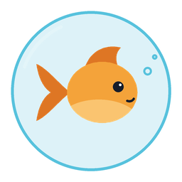
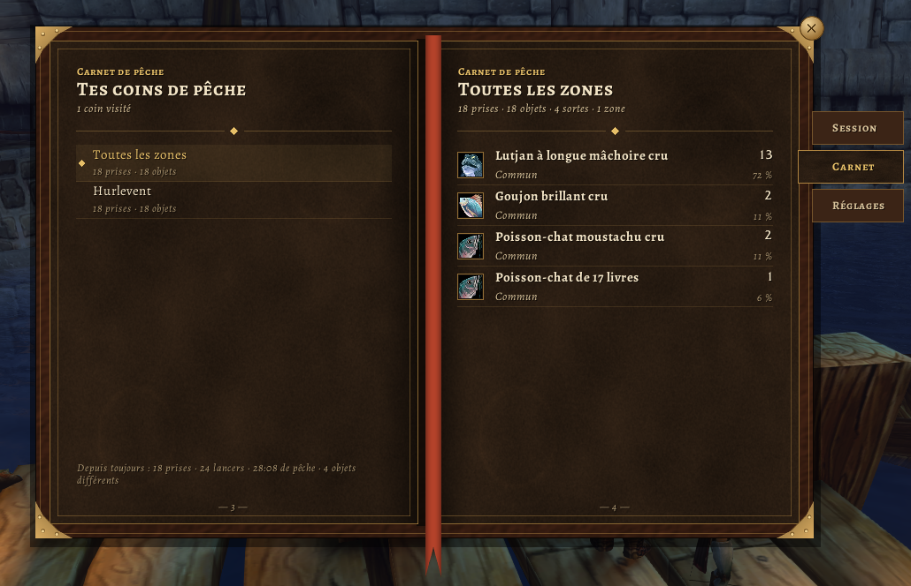
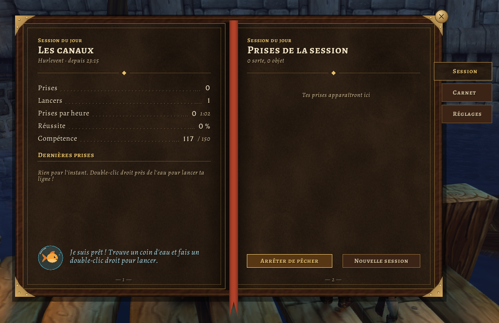
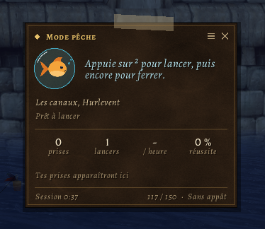

  

# Bubulle

[English version](README.md)

Addon de pêche pour **WoW Forever** (client 1.60.1).

Bubulle permet de lancer et de ferrer avec la même touche, monte le son du bouchon pendant la pêche, et note ce que tu attrapes dans chaque zone. Un petit poisson rouge, Bubulle, se tient à côté de ton écran et commente ta pêche de temps en temps.

  

  
  

## Ce qu'il fait

**Une touche pour lancer et ferrer.** Tu choisis ta touche la première fois que tu ouvres Bubulle. Une pression pour lancer, une autre quand le bouchon fait plouf. Tu peux aussi lancer d'un double-clic droit sur l'eau.

**Le plouf bien audible.** Pendant la pêche, les effets sonores montent et la musique et l'ambiance sont coupées. Tes réglages de son reviennent quand tu arrêtes, ou à ta prochaine connexion si le jeu a planté.

**Carnet de pêche.** Chaque prise est enregistrée par zone. La fenêtre montre ce que tu as pêché pendant la session, combien de poissons par heure, et combien de lancers ont vraiment rapporté quelque chose. Tu as une notification quand tu attrapes une nouvelle espèce ou un poisson rare.

**Un panneau pendant la pêche.** Il affiche le temps du bouchon, ta compétence de pêche (par exemple `110 (+52) / 150`), le temps restant de ton appât, tes dernières prises et les chiffres de la session. Il te prévient aussi quand tu n'as pas de canne équipée.

**Quatre styles.** Choisis ton look dans l'onglet Style : Carnet, Clair, Sombre ou WoW (comme les menus du jeu).

Le butin est ramassé automatiquement pendant la pêche. Il y a un bouton sur la minicarte, et chacune de ces fonctions peut être désactivée dans les options.

## Commandes

| Commande | |
|---|---|
| `/bubulle` | ouvrir la fenêtre |
| `/bubulle peche` | commencer ou arrêter le mode pêche |
| `/bubulle hud` | garder le panneau affiché ou masqué |
| `/bubulle options` | ouvrir les options |
| `/bubulle session` | commencer une nouvelle session |
| `/bubulle minimap` | afficher ou cacher le bouton de la minicarte |

Bouton de la minicarte : clic gauche pour ouvrir la fenêtre, clic droit pour le mode pêche. Fais-le glisser pour le déplacer.

## Questions

**La touche lance mais ne ferre pas.**
Le ferrage passe par la fonction « Interagir » du jeu, que Bubulle active pendant la pêche. Vérifie qu'aucun autre addon n'utilise la même touche.

**Je peux garder un autre addon de pêche ?**
Mieux vaut le désactiver. Deux addons qui gèrent le double-clic et le son en même temps se gênent.

## Limites

- La touche et le double-clic ne marchent pas en combat (aucun addon ne peut lancer de sort en combat).
- Français et anglais seulement pour l'instant.
- Bubulle fonctionne aussi sur Retail, sans les infos de compétence, d'appât et de canne.

## Bugs et suggestions

Ouvre un ticket sur [GitHub](https://github.com/Chauseth/bubulle/issues) avec ta version du jeu, ce que tu faisais, et le message d'erreur s'il y en a un.

## Licence

MIT, voir [LICENSE](LICENSE). Les polices incluses (Alegreya, Caveat) sont sous licence SIL Open Font License.
