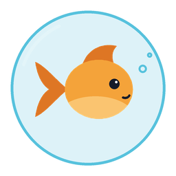

  

# Bubulle

[Version française](README.fr.md)

Fishing addon for **WoW Forever** (client 1.60.1). It also runs on Retail.

Bubulle lets you cast and hook with the same key, makes the bobber splash louder while you fish, and keeps track of what you catch in each zone. A small goldfish named Bubulle sits next to your screen and comments on your fishing now and then.

## What it does

**One key to cast and hook.** You pick a key the first time you open Bubulle. Press it to cast, then press it again when the bobber splashes. You can also cast with a double right-click on the water.

**Louder splash.** While you fish, sound effects go up and music and ambience are muted. Your sound settings are put back when you stop, or at your next login if the game crashed.

**Catch log.** Every catch is saved by zone. The window shows what you caught during the session, how many fish per hour, and how many casts actually caught something. You get a notification when you catch a new species or a rare fish.

**Panel while fishing.** It shows the bobber timer, your last catches and the session numbers. On Forever, it also shows your fishing skill (for example `110 (+52) / 150`) and how long your lure has left, and it tells you when you have no fishing pole equipped.

Loot is picked up automatically while you fish. There is a minimap button, and each of these features can be turned off in the options.

## Install

1. Put the `Bubulle` folder in `World of Warcraft\_forever_\Interface\AddOns` (or `_retail_`).
2. In game, type `/bubulle` and choose your fishing key.

## Commands

| Command | |
|---|---|
| `/bubulle` | open the window |
| `/bubulle peche` | start or stop fishing mode |
| `/bubulle hud` | keep the panel shown or hidden |
| `/bubulle options` | open the options |
| `/bubulle session` | start a new session |
| `/bubulle minimap` | show or hide the minimap button |

Minimap button: left-click opens the window, right-click starts or stops fishing mode. Drag it to move it.

## FAQ

**Is it allowed?**
Yes. Addons can't cast spells by themselves. The cast only happens when you press your key or click, the same way an action bar button works.

**The key casts but doesn't hook.**
Hooking uses the game's "Interact" feature, which Bubulle turns on while you fish. Check that no other addon uses the same key.

**Can I keep another fishing addon?**
It's better to disable it. Two addons handling double-click and sound at the same time get in each other's way.

## Known issues

- The key and the double-click don't work in combat (no addon can cast in combat).
- Only English and French for now.

## Bugs and suggestions

Open an issue on [GitHub](https://github.com/Chauseth/bubulle/issues). Tell me your game version, what you were doing, and the error message if there was one.
